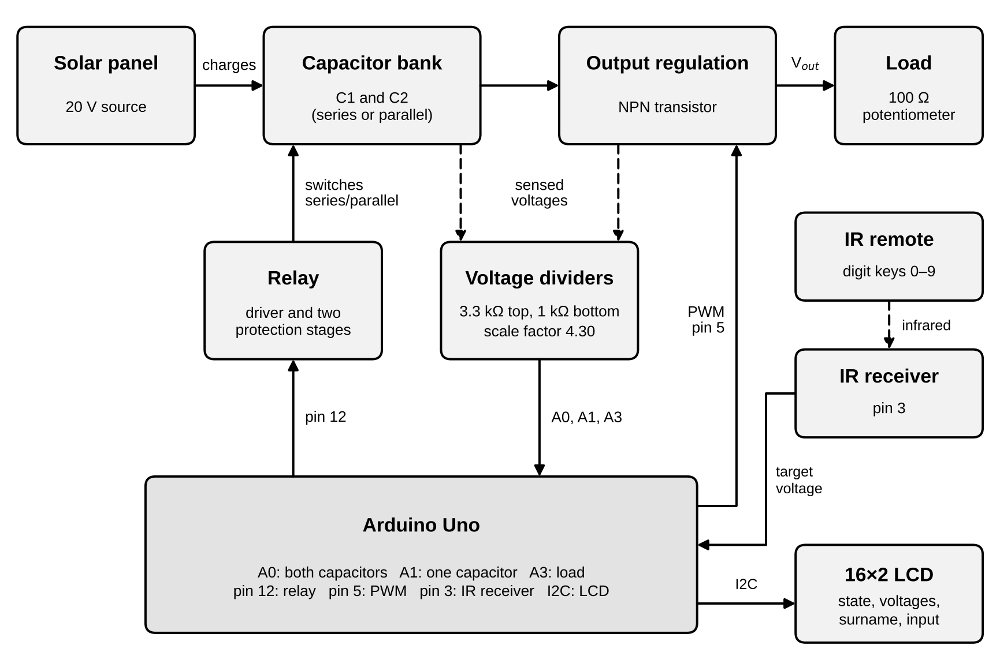
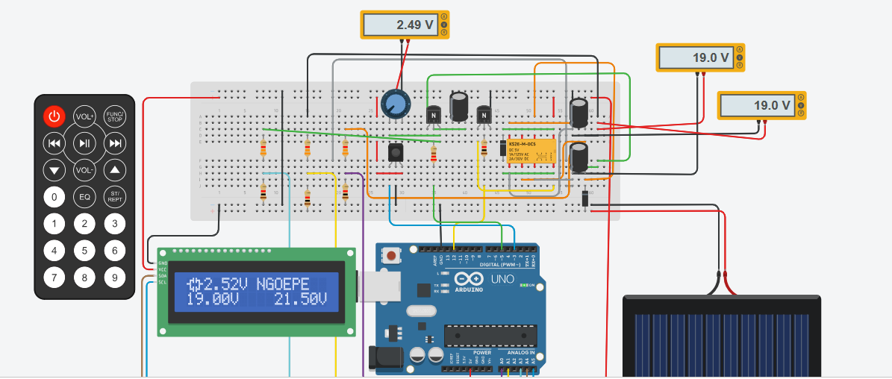
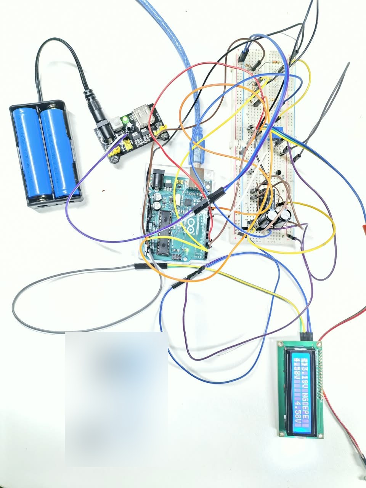

# Solar Supercapacitor Charge Controller

An Arduino Uno charge controller that replaces the battery in a small solar system with two capacitors. The Arduino switches the capacitors between series and parallel, regulates a user-selected output voltage with PWM, takes the target voltage from an infrared remote and shows live readings on a 16x2 LCD.

Built for the Embedded Systems 3 Final Integrated Systems Assessment (FISA) at the Cape Peninsula University of Technology (CPUT), 2026.

## Features

- Two 1000 µF capacitors as the energy store, switched between series and parallel by a DPDT relay
- Output regulated from 0 V to 4.3 V through an NPN transistor driven by filtered PWM
- Target voltage entered as two digits on an NEC infrared remote (for example `2` then `5` gives 2.50 V)
- Voltage sensing on three analogue pins through 3.3 kΩ / 1 kΩ dividers (scale factor 4.30, up to 21.5 V)
- 16x2 I2C LCD showing the series/parallel symbol, output voltage, total bank voltage and one capacitor's voltage

## Hardware

| Part | Value | Arduino pin / role |
| --- | --- | --- |
| Arduino Uno | | Controller |
| Solar cell | 20 V | Source, through diode D1 |
| C1, C2 | 1000 µF | Capacitor bank |
| K2 | DPDT relay | Series/parallel switching, driven by T2 from pin 12 through 1 kΩ (R1), flyback diode D2 |
| T1 | NPN transistor | Output regulator, base from pin 5 (PWM) through 220 Ω (R5) |
| C3 | 47 µF | PWM filter at T1's base (cut-off about 15.4 Hz) |
| RPOT2 | 100 Ω potentiometer | Load |
| R6 / R3 | 3.3 kΩ / 1 kΩ | Divider to A0: total bank voltage |
| R2 | 3.3 kΩ | To A1: one capacitor's voltage (see Known issues) |
| R9 / R4 | 3.3 kΩ / 1 kΩ | Divider to A3: output voltage |
| IR receiver | | Pin 3 |
| 16x2 LCD with I2C backpack | Address 0x27 | SDA A4, SCL A5 |

The full schematic is in [`hardware/tinkercad-schematic.pdf`](hardware/tinkercad-schematic.pdf).

| Simulation (Tinkercad) | Physical build |
| --- | --- |
|  |  |

In the physical build, a lithium cell pack and a breadboard power module stand in for the solar panel.

## How it works

**Switching.** Each condition must hold for 5 checks in a row, 100 ms apart, and the controller stays in a mode for at least 1 second.

- Parallel to series: one capacitor is at or below the target + 0.30 V, and the bank is above 0.80 V.
- Series to parallel: both capacitors are at or above the target + 0.50 V, and they are within 0.20 V of each other.

**Regulation.** Every 100 ms the PWM duty on pin 5 steps up or down until the output is within ±0.02 V of the target. The transistor can only drop voltage, so the output cannot rise above the bank voltage.

**Voltage reading.** True voltage = (ADC reading × 5.0 V ÷ 1023) × 4.30.

## Getting started

1. Install the [Arduino IDE](https://www.arduino.cc/en/software).
2. Install these libraries from the Library Manager: **IRremote** and **LiquidCrystal I2C**.
3. Open [`firmware/solar_charge_controller/solar_charge_controller.ino`](firmware/solar_charge_controller/solar_charge_controller.ino), select **Arduino Uno** and upload.
4. Open the Serial Monitor to see the logged voltages.

The IR command codes in the sketch are for a remote with address `0xBF00` (the Tinkercad remote). For a different remote, read its codes from the Serial Monitor and update the mapping in the sketch.

## Known issues

- **A1 reads at the top of its range in simulation.** A1 has no 1 kΩ resistor to ground, so it isn't divided down and reads 21.50 V. Add a 1 kΩ resistor from A1 to ground.
- **Display hold is 500 ms.** The brief asked for 1 second; change the three `millis() + 500` lines that set `temporaryScreenUntil` to `millis() + 1000`.
- **Series/parallel switching was not captured in the test evidence.** All recorded runs were in parallel mode.
- **IR repeat frames are not filtered**, so holding a key may enter a digit twice.
- **Stored energy is small** (about 0.36 J at 19 V in parallel), so the design suits only low-power loads for short periods.

## Documentation

- [Project report (PDF)](docs/FISA-report-public.pdf): design, calculations, simulation and physical results, and findings
- [Serial monitor, simulation](docs/images/serial-monitor-simulation.png) and [physical circuit](docs/images/serial-monitor-physical.png)

## Author

Lekgothe Gedion Ngoepe, Cape Peninsula University of Technology
